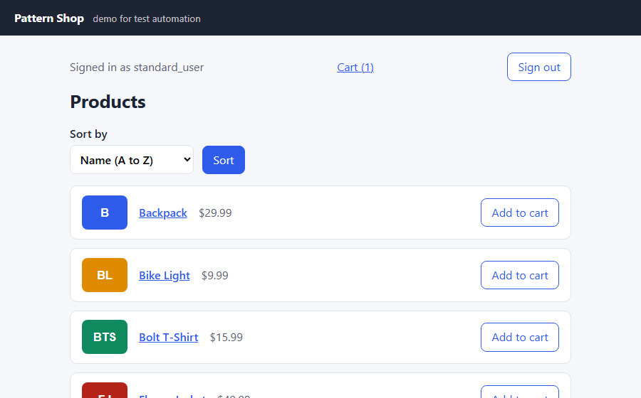
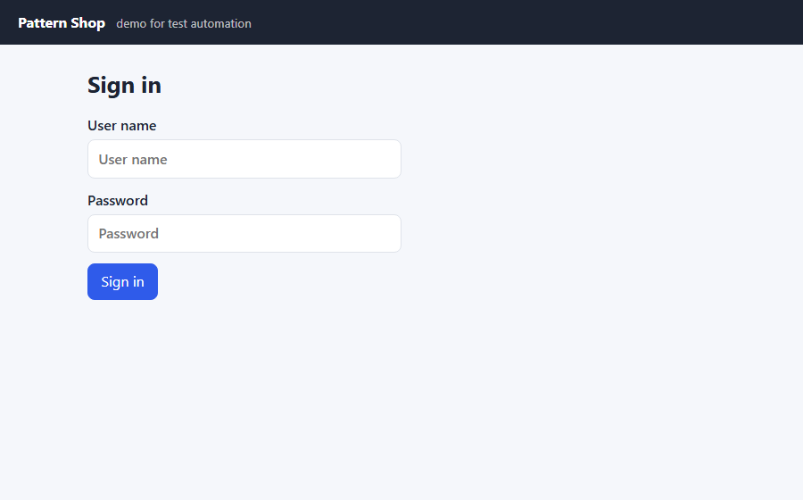
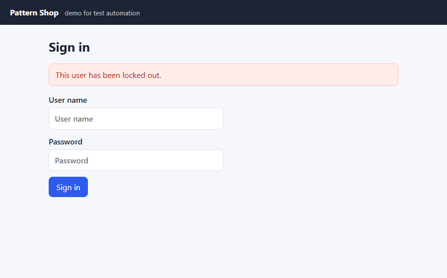
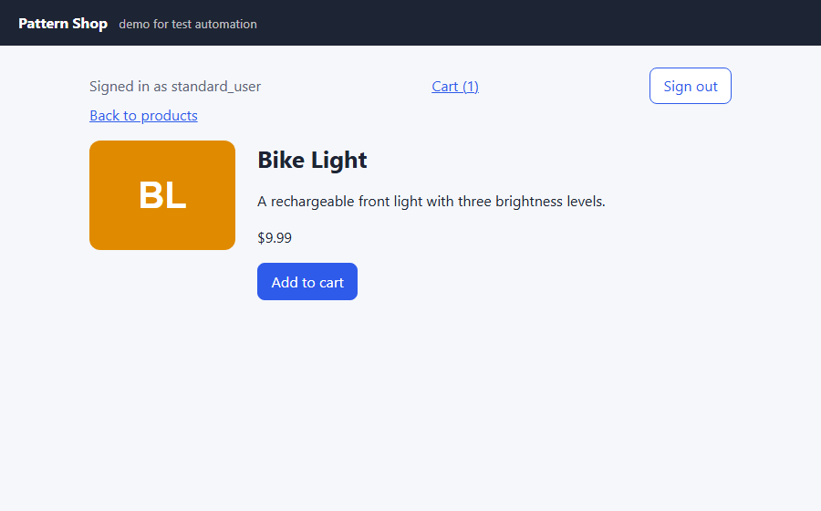
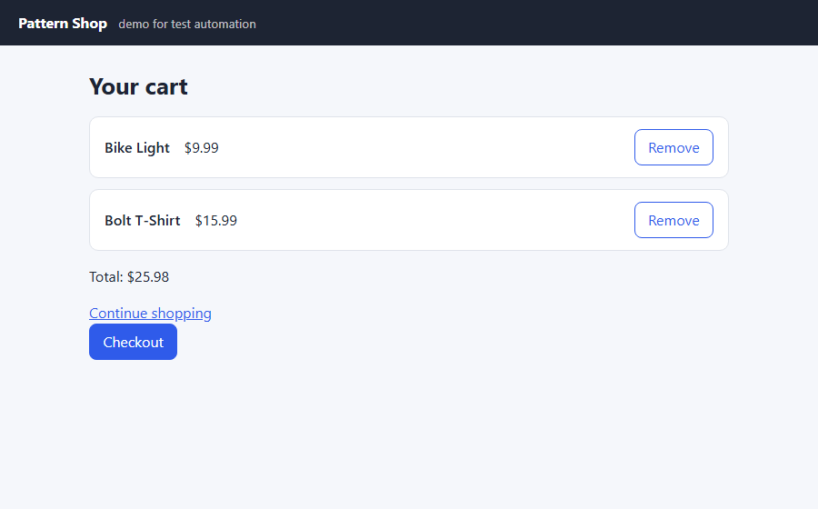
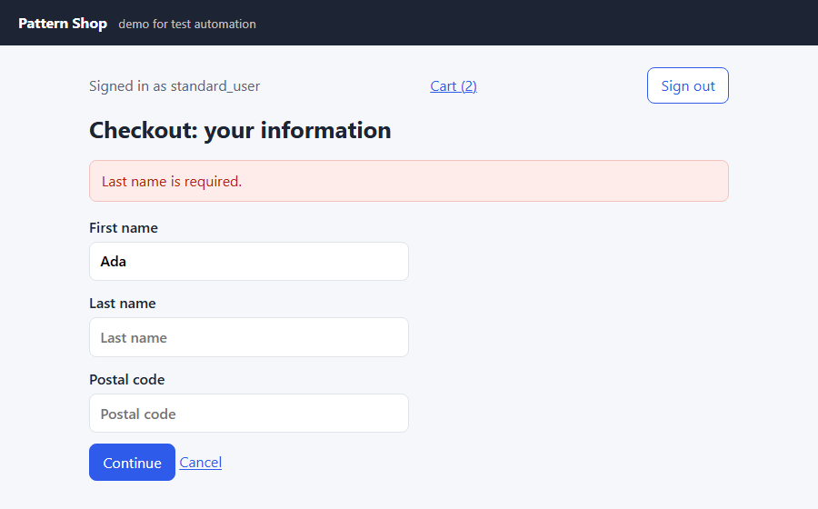
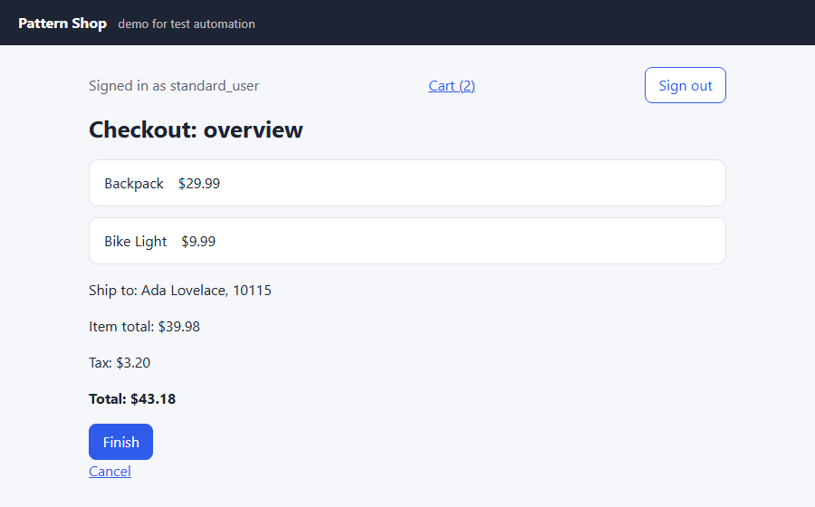
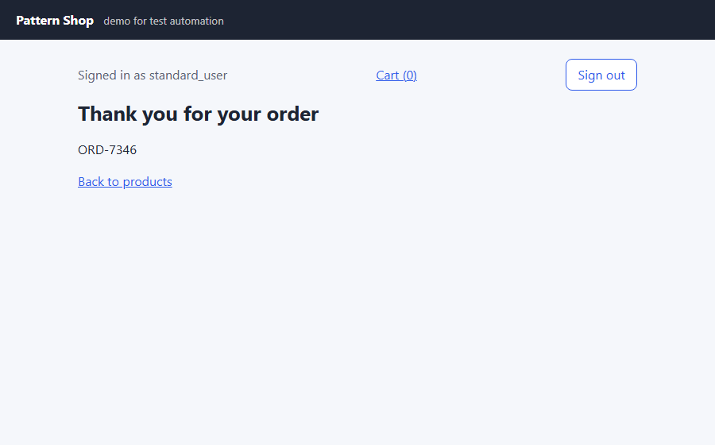

# Pattern Shop: a demo application for test automation

[](https://github.com/niranjankagri/pattern-shop-demo-app/actions/workflows/ci.yml)

A small shop built to be tested: sign-in, a sortable product list, a page per product, the cart and a two-step checkout, and the same catalog through three
different APIs (REST/JSON, SOAP-style XML and a legacy text format). It is shared by my test automation frameworks,
so they test one application I control instead of public demo sites that can be slow or down.

**Live demo: https://pattern-shop.onrender.com** (sign in as `standard_user` / `secret_sauce`)



| | |
|---|---|
| Runtime | JDK only (`com.sun.net.httpserver`), no dependencies; compiled for Java 21, runs on Java 25 in the image; starts in under a second |
| Image | `ghcr.io/niranjankagri/pattern-shop-demo-app:latest` (and `:sha-<commit>`), published by CI from `main` |
| Hosted demo | https://pattern-shop.onrender.com: Render free plan, from [`render.yaml`](render.yaml); it sleeps when idle, so the first request can take about a minute |
| Tests | 31 JUnit 6 tests over real HTTP, plus a smoke test of the built image |

## Pages

| Sign in | Locked user |
|---|---|
|  |  |
| **Product page** | **Cart** |
|  |  |
| **Checkout: your information** | **Checkout: overview** |
|  |  |
| **Order complete** | |
|  | |

## How the frameworks use it

```text
framework CI job ──▶ docker run ghcr.io/.../pattern-shop-demo-app ──▶ tests against http://localhost:8080
                     (fresh shop per job: fast, no shared data, never down)

people, demos     ──▶ hosted demo on Render (https://pattern-shop.onrender.com)
```

Framework CI never depends on the hosted demo. Used by:
[design-patterns-test-framework](https://github.com/niranjankagri/design-patterns-test-framework) (Selenium and
Playwright for Java).

## Run it

```bash
docker run -d -p 8080:8080 ghcr.io/niranjankagri/pattern-shop-demo-app:latest
# or from source:
./mvnw package && java -jar target/pattern-shop.jar          # port 8080, or $PORT
```

Open http://localhost:8080 and sign in as `standard_user` / `secret_sauce`.

## What it offers

**Users** (password `secret_sauce` for all): `standard_user` and `visual_user` sign in; `locked_user` gets
"This user has been locked out."; a wrong password or unknown user gets "User name and password do not match any
user."; empty fields get "User name and password are required." Two users behave differently on purpose:
`problem_user` sees the same placeholder picture for every product (a broken page for a test to find), and
`slow_user` is signed in only after 3 seconds (for waits and timeouts). Opening a page behind the sign-in while
signed out leads to the sign-in page with "Please sign in to see that page."

**Pages** (plain HTML forms, no JavaScript; every element a test needs has a `data-testid`, and every form field
also has an `id`, a `name`, a placeholder and a label, so locator strategies can be compared):

| Path | Content | Test ids |
|---|---|---|
| `/login` | sign-in form, error message | `username`, `password`, `login-button`, `login-error` |
| every page after sign-in | who is signed in, cart counter, sign-out | `welcome`, `cart-link`, `cart-count`, `logout` |
| `/products?sort=` | catalog with pictures; sort `name-asc` (default), `name-desc`, `price-asc`, `price-desc` | `product-card`, `product-image`, `product-name` (link to the product page), `product-price`, `add-<id>`, `sort`, `sort-apply` |
| `/product?id=<id>` | one product: picture, description, price | `product-detail-image`, `product-detail-name`, `product-detail-description`, `product-detail-price`, `add-<id>`, `back-to-products` |
| `/cart` | items, total, remove, checkout | `cart-item`, `cart-item-name`, `cart-total`, `remove-<id>`, `checkout`, `continue-shopping` |
| `/checkout/info` | step 1: first name, last name, postal code (each required, in that order: "First name is required." ...) | `first-name`, `last-name`, `postal-code`, `continue`, `cancel`, `checkout-error` |
| `/checkout/overview` | step 2: items, ship-to, item total, 8 % tax (rounded to the cent), total | `overview-item`, `overview-item-name`, `overview-item-price`, `ship-to`, `subtotal`, `tax`, `total`, `finish`, `cancel` |
| `/complete` | order confirmation | `complete-title`, `order-number`, `back-to-products` |

Product pictures are SVGs at `/img/<id>.svg` (the placeholder is `/img/placeholder.svg`). Adding a product returns to
the page it was added from (the product page, or the list in the same sort order).

**APIs** (the same four products in three formats, for adapter and contract tests):

| Endpoint | Format | Example |
|---|---|---|
| `GET /api/products` | JSON, prices in cents | `{"id":"P-200","name":"Bike Light","priceCents":999}` |
| `POST /soap/catalog` with `<GetProducts/>` | SOAP-style XML envelope, prices in dollars | `<product><code>P-200</code><title>Bike Light</title><price currency="USD">9.99</price></product>` |
| `GET /legacy/catalog?q=ALL` | text lines `CODE\|NAME\|PRICE`, upper-case names | `P-200\|BIKE LIGHT\|9.99`; errors as `ERR\|QUERY` |
| `GET /api/test-data/users` | JSON: the demo users and their state | for a test-data service strategy |
| `GET /health` | `ok` | container and hosting health checks |

Sessions and carts are kept in memory per browser session (cookie `SESSION`), so parallel tests do not share a cart.
The hosted demo keeps at most 10,000 sessions and then starts over.

## CI

[`ci.yml`](.github/workflows/ci.yml) on every pull request, push to `main`, weekly (Friday 23:00 UTC) and on demand:

1. **App tests**: `./mvnw verify` (31 tests over HTTP).
2. **Image build and smoke test**: builds the Docker image, waits for its health check, runs
   [`scripts/smoke.sh`](scripts/smoke.sh) (sign-in, cart, the two-step checkout, all three APIs). On `main` the tested image is published to
   ghcr.io as `:latest` and `:sha-<commit>`.

`scripts/smoke.sh <url>` also checks the hosted demo (`bash scripts/smoke.sh https://pattern-shop.onrender.com`, passed on
20 Nov 2026); it waits up to 90 s for a sleeping free instance.

## License

[MIT](LICENSE)
